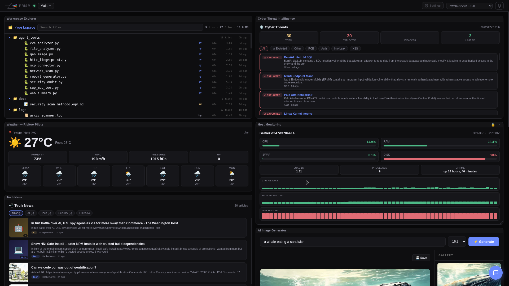
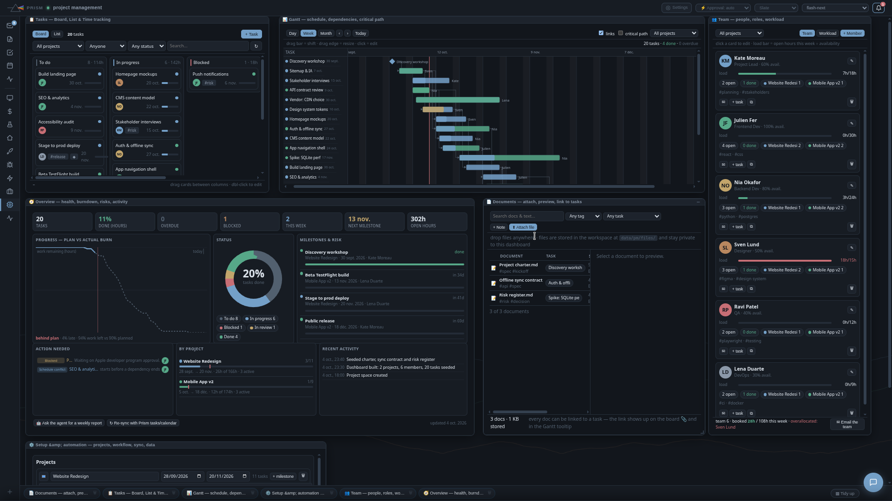
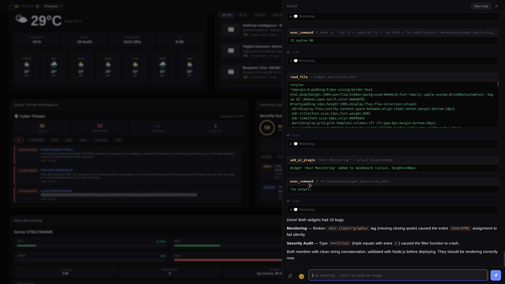
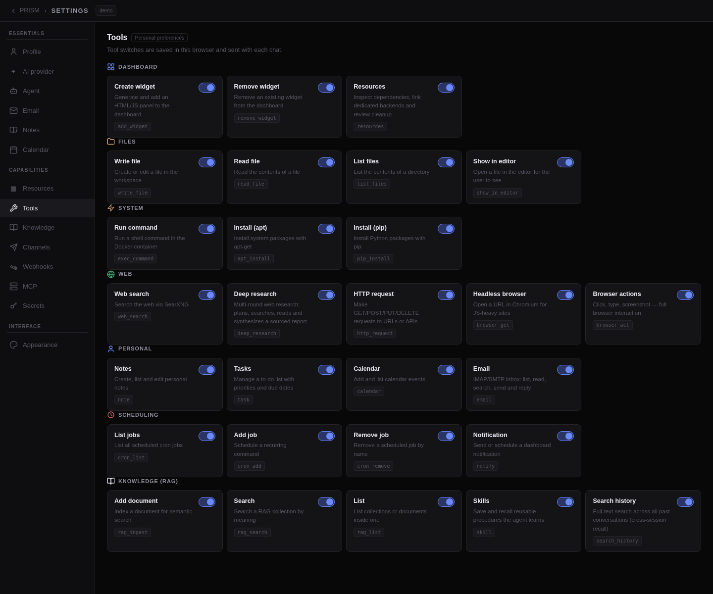

#  PRISM

**Programmable Responsive Interface for Smart Models**

*Also known as: Probably Runs Interesting Stuff Magically*

**[Documentation](https://www.thelastserver.com/docs/installation/)** · [1.0 release notes](docs/releases/v1.0.0.md)

Yes, another AI dashboard. Except this one runs on your own hardware, with local models or the AI providers you choose, and has the slightly unsettling property of being able to modify its own environment.



<details>
<summary>More screenshots</summary>





</details>

---

## The idea

This started as frustration with tools like [OpenClaw](https://openclaw.ai) and [Hermes](https://hermes-agent.nousresearch.com) — both promising, both Node.js (make of that what you will), and both operating on the same fundamental assumption: the agent lives somewhere in the background, has direct access to your disk, and you talk to it through a chat box that it has absolutely no influence over. Which is fine, until you realize that a truly useful agent should be able to shape its own workspace, not just occupy it.

PRISM is built around a different premise: the agent has actual agency over its environment. It runs code in a sandboxed workspace (not on your host machine — you're welcome), builds interactive widgets and pins them directly to the dashboard it lives in, schedules tasks, searches the web, queries a private knowledge base, and — if it needs a capability it doesn't have — it can define new tools and use them immediately, or connect a remote MCP server and configure it entirely on its own.

You ask it to monitor something, it builds a widget. You ask it to set up a GitHub integration, it connects the MCP server, fetches its auth token, and gets to work. You ask it to remember a document, it indexes it with embeddings and will bring it up when relevant.

Is this a great idea? Probably. Does it make you slightly nervous? It should. That's how you know it's doing something real.

---

## Quick start

See the [installation guide](https://www.thelastserver.com/docs/installation/) for detailed setup instructions and links to the configuration reference.

Install Git and Docker with the Compose v2 plugin. The standard images support
Linux AMD64 and ARM64. You can use a local model server or an API provider;
you will connect it in Prism's interface after startup.

Run the following commands in a terminal **on the Docker host**.
The default stack needs host ports **48080** for Prism and
**80** for the service proxy to be available.

**1. Install.**

```bash
git clone https://github.com/blazux/prism
cd prism
cp .env.example .env
```

Open `.env`, find the commented `# PRISM_TOKEN=change-me` line, remove its leading
`#` and replace `change-me` with a long, private token. This will be your personal
dashboard login.

Choose the installation mode **before starting for the first time**:

- **Personal:** leave `MULTI_USER` commented out.
- **Shared:** uncomment `MULTI_USER=1`. You will create the first administrator
  account when you open Prism; see [Personal, or shared](#personal-or-shared).

Keep the remaining defaults for a standard installation. Models and AI keys can
be configured in the interface.

**2. Start Prism.**

From the `prism` directory created above:

```bash
docker compose pull
docker compose up -d --no-build
```

This starts the published server and execution workspace, PostgreSQL, SearXNG
and Traefik. To compile your checkout instead, use the
[local-build instructions](#docker-installation-and-updates).

On the Docker host, open [http://localhost:48080](http://localhost:48080).
In personal mode, sign in with your token. In shared mode, create the first
administrator account. If Docker runs on another machine, use that machine's
address or your configured reverse-proxy URL: `localhost` in your browser refers
to the machine running the browser.

**3. Connect your first model.**

Open **Settings → AI provider**, or **Admin → AI provider** in shared mode:

1. Select a source or click **+ Add a source**. Choose **OpenAI**, **Anthropic**, **Ollama** or **Other compatible** (vLLM, SGLang, llama.cpp…). OpenAI and Anthropic have preset URLs; for a local or compatible server, enter its URL and a key if required.
2. Click **Connect**, then choose a model that supports tool calling. Choosing it saves automatically. Local models must already be installed on your model server.
3. Click **Use as default** for the source you want, if it is not already the default. You can now talk to the agent. **Model settings…** lets you override the context window and image support for an individual model; its **Save** does not change your default model.

For Ollama running on the Docker host, use `http://host-gateway:11434`; for an OpenAI-compatible server, include `/v1` in its URL. `localhost` inside the Prism container refers to that container, not your host.

Choose your timezone in **Settings → Profile**. For document search, configure
an embedding model too; see [Choosing your backend](#choosing-your-backend).

### Optional local Notes vault

To use an existing Obsidian/Logseq folder, set `NOTES_VAULT_PATH=/absolute/path/to/MyVault`
in `.env` (the folder must be on the Docker host), then run
`docker compose up -d --no-deps prism-server`. In **Settings → Notes**, select
**Markdown vault** and enter `/vault`. Prism reads and writes this folder;
existing database notes are not automatically moved. Leave the variable unset
if you use database notes. This option is for self-hosted Prism, not Prism Cloud.

### The documentation is the agent

Once your first model is connected, **just ask the agent**. It has Prism's built-in documentation and tools to help configure the app, add other AI sources, choose models and set up embeddings. For example:

- “Help me add another model provider.”
- “Configure embeddings so I can search my documents.”
- “How do I connect my mailbox?”

Enter credentials through the secure settings form or the secret prompt the agent opens, rather than pasting keys into chat.

## Choosing your backend

You can keep several AI sources configured at once, including several servers of the same type. Choose a default source/model for conversations and app actions; the chat model picker also offers models from the other sources. Each source has its own connection and credential.

For document search, the **Embeddings** section lets you reuse the default source with **Use same provider**, select another existing source, or enter a dedicated connection. Choose an embedding model and click **Test embeddings**. Anthropic does not provide an embedding endpoint, so choose another source for that part.

Click **Save changes** to apply embedding settings automatically, without restarting Prism. Settings displays progress if the document index needs rebuilding.

Changing the embedding model or endpoint requires confirming the index rebuild in the form. Prism rebuilds from stored text; there is no need to upload your documents again. The agent can guide you through this too.

The `.env` AI settings remain available as server defaults for existing installations. The interface takes precedence once saved; **Use server settings** restores those defaults.

---

## Docker installation and updates

The standard installation uses **one `docker-compose.yml`** for both personal
and shared mode. The Dockerfiles build images; they are not extra stacks to
start. You do not need to open or edit them to run published images.

| File | Purpose |
|---|---|
| `docker-compose.yml` | Starts the server, execution workspace, database, search engine and service proxy. Proton Mail Bridge is optional. |
| `Dockerfile` | Builds the Prism server and its web interface. |
| `Dockerfile.agent` | Builds the CPU execution workspace: languages, packages, browser and cron. Its published image is `blazux/prism-workspace:latest`. |
| `Dockerfile.agent.gpu` | Builds a local `blazux/prism-workspace:gpu` image with PyTorch/CUDA for code that uses a GPU. See the NVIDIA setup below. |
| `Dockerfile.protonmail-bridge` | Builds the optional Proton Mail Bridge service. See its [setup guide](docs/help/protonmail-bridge.md). |

The name `agent` in a Dockerfile refers to its **execution workspace**. The
agent's conversation loop runs in `prism-server`. Your chat model runs at the AI
provider you configure; a GPU workspace does not move or accelerate that model.

Run installation commands on the Docker host, from the repository root. If your
deployment uses explicit project names, Compose files or environment files,
keep the same `-p`, `-f` and `--env-file` options for every operation.

### Published images

The default `:latest` tags follow stable releases. The pipeline publishes builds
from `main` under `:unstable`; pulling `:latest` does not deploy every commit on
`main`. To run your current checkout, use the local-build procedure below.

Before updating, let active agent tasks finish and back up the database,
workspace and server-private volumes. Recreating the server interrupts its
running tasks.

Update the standard CPU installation:

```bash
git pull --ff-only
docker compose pull
docker compose up -d --no-build
```

### Build from source

To build and run the source code in your checkout:

```bash
docker compose up -d --build
```

After a later `git pull --ff-only`, repeat this build command. `git pull` alone
does not replace running images. Local builds use the image names declared in
Compose; a later `docker compose pull` can replace them with published images.

### Optional NVIDIA workspace

Use this variant when the **code executed by the agent** needs PyTorch/CUDA.
It does not move or accelerate your configured chat model. The Docker host
needs a compatible NVIDIA GPU, driver and NVIDIA Container Toolkit configured
for Docker.

Set `WORKSPACE=gpu` in `.env`. Leave `WORKSPACE` unset or empty for the standard
CPU workspace; values such as `cpu` or `false` are not supported and will make
the build fail on a missing Dockerfile. The GPU workspace is built locally under
`blazux/prism-workspace:gpu`. Its first build downloads the NVIDIA base image
and installs the workspace packages, requiring additional time and disk space.
See [Docker's GPU setup guide](https://docs.docker.com/compose/how-tos/gpu-support/)
for host prerequisites.

In the repository root, create a local `docker-compose.override.yml` containing
the following. If this file already exists, merge these keys into its existing
`services.workspace` section, preserving its other services and settings.
**Do not replace an existing override with this fragment.**

```yaml
services:
  workspace:
    pull_policy: build
    deploy:
      resources:
        reservations:
          devices:
            - driver: nvidia
              count: all
              capabilities: [gpu]
```

The override is ignored by Git and loaded automatically by `docker compose`
with the standard filenames. If you normally pass `-f`, include this override
explicitly as well. Keep the same files, project and environment options for
every command.

Start the installation, allowing Compose to build the GPU workspace:

```bash
docker compose up -d
```

To update it while keeping a published Prism server, pull only the published
services, then start Compose again to rebuild the GPU workspace:

```bash
git pull --ff-only
docker compose pull prism-server postgres searxng traefik
docker compose up -d
```

For a server built from your checkout instead, use `docker compose up -d --build`.
The `pull_policy: build` setting ensures that workspace startup uses a local
build rather than requesting a `:gpu` image from Docker Hub.

### Optional Proton Mail Bridge

Bridge is enabled separately with the `protonmail` profile and currently
requires an AMD64 host. Follow the [Bridge setup guide](docs/help/protonmail-bridge.md)
to sign in to Proton, start the permanent service and connect Prism with the
generated mail-client credentials.

See [the upgrade guide](docs/UPGRADING.md) for persistence and compatibility
details. `docker compose down -v` deletes volumes; it is not an update command.

---

## Stack

| Layer | Tech |
|---|---|
| Backend | Go |
| Frontend | Vanilla JS, custom free-floating window manager |
| LLM | Ollama — or any OpenAI-compatible server (vLLM, SGLang, TGI, …), or Claude |
| Embeddings | Ollama, or the same OpenAI-compatible server |
| Vector store | PostgreSQL + pgvector |
| Web search | SearXNG |
| Service routing | Traefik |
| Messaging | Telegram / Slack / Webex bridge |
| Integrations | Email (IMAP/SMTP), CalDAV, Todoist, Google, Microsoft, Obsidian/Logseq |
| Modes | Personal (single user) or shared (accounts, groups, rooms) — one flag |
| Runtime | Docker / Docker Compose |

---

## Embedded services

Docker services use the host daemon by default (DOCKER_MODE=host).
For a workspace with its own preconfigured Docker daemon, select
DOCKER_MODE=workspace; see [Docker backends](docs/help/docker-backends.md)
for prerequisites and internal URLs. This does not install a daemon or enable
privileged containers automatically. The Traefik setup below describes host mode.

The agent can spin up full Docker containers on demand — Uptime Kuma, Jupyter, Grafana, ComfyUI, whatever has an image. Each service gets its own subdomain and is embedded directly in the dashboard as a widget iframe.

When the agent calls `docker_run`, Prism:
1. Auto-allocates a host port from the range `20000–20999`
2. Adds Traefik labels so the container is routed via `http://<name>.localhost/`
3. Strips `X-Frame-Options` so the service can be embedded as an iframe from the dashboard

Chrome and Firefox resolve `anything.localhost` to `127.0.0.1`. These service
URLs work when the browser and Docker run on the same machine, with Traefik on
port 80. A remote installation needs reachable service URLs and matching
reverse-proxy configuration; `*.localhost` in a visitor's browser will not point
at your server. Services are served at `/`, which supports applications using
root-relative routes, assets and WebSockets.

Traefik watches the Docker socket and updates routes when containers appear or
disappear. `docker_run` configures the service's routing labels automatically.

To embed a service the agent has started, a widget uses a plain iframe:

```html
<iframe src="http://uptime-kuma.localhost/" style="width:100%;height:100%;border:none"></iframe>
```

---

## The apps (yes, it has a personal life now)

An assistant that can't see your actual life is just a fancy autocomplete. So Prism plugs into the boring-but-essential stuff, and the agent drives all of it from chat — or you can, from the command palette (**Ctrl+K**):

- **Email** — reads and sends through your IMAP/SMTP mailbox (a ProtonMail Bridge container is included, because of course you use ProtonMail). Tag and triage, search, reply, send **with attachments**, get your inbox summarized, or turn an email into a task or a calendar event. Pair it with cron and it'll DM you a morning digest over Telegram. Browse and manage folders, move/archive/trash messages, and set simple inbox rules that run without a model call.
- **Calendar & Tasks** — events and to-dos in Prism's own database out of the box; connect **CalDAV** (Apple iCloud, Nextcloud, Fastmail) or **Todoist** for tasks, and **Google** or **Microsoft** for your calendar. "Add lunch with Sam Friday at noon" does what you'd hope.
- **Notes** — Markdown with `[[wikilinks]]`, a split editor with an AI toolbar, and an "Add to knowledge" button that shoves a note straight into a RAG collection. Lives in Prism's database, or in your existing **Obsidian / Logseq vault** (just a folder of `.md` files).
- **Terminal** — a real, full TTY into the agent's workspace container. Toggle with **Ctrl+Enter**. `vim`, `htop`, colours, package installs — all work. For when you trust the agent right up until you don't.
- **Reach it from anywhere** — **Telegram**, **Slack** and **Webex** bridges, so you can bother the agent from your phone while pretending to work.

Connecting an account is a one-time OAuth click or an app password in **Settings**. Prism never hosts a shared OAuth app — you create your own, because your calendar is nobody's business but yours.

### Telephony with PrismVox

Connect [PrismVox](https://github.com/blazux/PrismVox) from **Settings → Telephony**
in personal mode, or **Admin → Telephony** as a global administrator in shared
mode. Enter the phone service address and its console credentials, then the
Prism address reachable from that service. **Test connection** checks the link
without placing a call. **Connect** saves the two-way connection; credentials
remain encrypted on the servers. Existing environment-based installations remain
supported.

Choose the receptionist/outbound model from your configured Prism sources, or
retain the Vox deployment model. Recognised callers use their personal Prism
assistant and permitted resources; other callers use the receptionist's public
knowledge and tools. Configure the voice, greetings, SIP line, directories and
access in the same settings area.

The **Telephony** app shows call archives, transcripts, tool results and outbound
missions. Its contextual actions prepare a question for your normal assistant
or the selected group's Room. Previous Vox supervision conversations remain
available as read-only archives. See the [telephony guide](docs/help/telephony.md)
for phone permissions and agent workflows.

---

## Webhooks: let anything talk to the agent

Point any system that can make an HTTP call at a webhook URL and its payload
becomes an agent turn, wrapped in a prompt you write. Grafana fires an alert, a
form gets submitted, CI goes red, a sensor trips — the agent receives it with its
whole toolset and does whatever the prompt says: triage it, chart it, file a
task, wake you on Telegram.

```bash
curl -X POST "https://your-prism/api/webhook/<id>?token=<token>" \
     -d '{"alert":"disk","host":"gx10","pct":97}'
```

Configure them in **Settings → Webhooks**: the prompt (with `{{content}}` where
the payload goes), which chat session it runs in, an optional model, and whether
to push the answer to Telegram/Slack/Webex. Calls return `202` immediately and
the agent works in the background — tick a box if you'd rather wait for its
reply in the response.

> The URL carries its own token and sits outside the dashboard login, because
> senders are machines with no account. Anyone holding it can make your agent
> run — treat it like a password.

---

## Personal, or shared

Same binary, one flag. Decide which you are before the first `up`:

| | **Personal** (default) | **Shared** (`MULTI_USER=1`) |
|---|---|---|
| Who it's for | You. Maybe your household on the NAS. | A team, a lab, an association — several people, one Prism |
| Login | `PRISM_TOKEN`, or nothing at all | Accounts: email + password, signup page |
| Who's admin | Whoever reaches the port | The first person to sign up; they approve everyone after |
| Agents | Your agent, your workspaces | Everyone gets their own agent **plus** a shared agent per group |
| Integrations (mail, calendar, OAuth…) | Global | Scoped per user — your mailbox is yours |
| Where to configure | Settings | Settings for yourself, **Admin console** for the deployment |

> Personal mode without `PRISM_TOKEN` means *anyone who can reach the port is you*. Fine on a laptop; set the token the moment the box has a LAN address.

### How shared mode works

**Accounts.** The first signup becomes the global admin, auto-approved. Every later signup lands as *pending* and can't log in until an admin approves it in **Admin → Users** (admins are notified). No open registration by surprise.

> **This is a trusted-team feature, not a public SaaS tenancy.** The people
> getting accounts are colleagues: they sent the CV, survived the interview and
> signed the contract. Prism gives an agent real power over its environment on
> purpose, so the default is that approved members may use that power too. Tool
> policies are there for teams that want a tighter arrangement, not because an
> account is assumed to be an attacker in a fake moustache.

**Groups** are the unit of collaboration. The global admin creates them and adds members; a member can be promoted to *group admin* for that group. Each group has:

- a **shared agent** — its own name, avatar, model, system prompt and turn budget, configured by a group admin. It lives in the group's **Room**, a chat where members talk to each other and to the agent by @mention, and it's the one that answers on the group's **Webex** bot;
- a **knowledge base** and **MCP servers** shared with the whole group — the shared agent and every member's personal agent can use them, members see them read-only;
- **group secrets** for those MCP servers and tools;
- a **tool policy**: the global admin sets the ceiling for every tool (*open to members* / *admins only* / *disabled*), a group admin can only tighten it for their group. Everything is open by default — this is a cockpit for a trusted crew, not a sandbox for strangers on the internet.

**What stays personal.** Each member keeps their own agent, personality, workspaces, chat history, and their own integrations. Group things are additive: your agent gains the group's knowledge base, it doesn't lose yours.

### Switching

> **Turning `MULTI_USER` on is a one-way door.** At the first start in shared mode, Prism migrates the deployment's existing config keys and secrets into the scope of the first admin — so *you* must be that first signup, or your mail and calendar settings end up belonging to whoever beat you to it. Single-user mode won't find them afterwards. Starting from a fresh volume is the clean way; flipping an existing install works as long as you sign up first.

---

## It remembers, and occasionally learns

Prism keeps a memory of who you are and how you work, records lessons from problems it stumbled through, and saves multi-step jobs as reusable **skills** — so the second time you ask, it doesn't reinvent the wheel. Long conversations get summarized automatically, and it can full-text search everything you've ever discussed, which means it (mostly) stops asking you to repeat yourself. Secrets you hand it are stored **AES-256-GCM encrypted**, not in a plaintext file it'll cheerfully commit to Git.

---

## Configuration

Use **Settings** for everyday configuration, or ask the agent. In multi-user mode, deployment-wide AI settings are in **Admin → AI provider**.

The `.env` file supplies installation settings and optional AI defaults. Docker Compose reads it on `up`; the standard values are provided in [`.env.example`](.env.example).

<details>
<summary>Environment reference for existing or custom installations</summary>

### Optional model defaults

| Variable | What | Example |
|---|---|---|
| `OLLAMA_URL` | Your Ollama instance | `http://host-gateway:11434` |
| `OLLAMA_MODEL` | Chat model (pulled) | `qwen3.6:27b` |
| `EMBED_MODEL` | Embedding model (pulled) | `qwen3-embedding:8b` |

### Backends

| Variable | What | Default |
|---|---|---|
| `LLM_BACKEND` | Default chat backend: `ollama`, `openai` or `anthropic` | `ollama` |
| `OPENAI_BASE_URL` | `/v1` root of an OpenAI-compatible server | — |
| `OPENAI_MODEL` | Its chat model (`--served-model-name`) | — |
| `OPENAI_API_KEY` | Bearer token, if the server wants one | — |
| `OPENAI_REASONING_EFFORT` | `low` / `medium` / `high` / `xhigh` / `none` for reasoning models (the set a model accepts varies); users override it in Settings → Agent | `medium` |
| `ANTHROPIC_API_KEY` | API key from console.anthropic.com (not a subscription token) | — |
| `ANTHROPIC_MODEL` | Default Claude model | `claude-sonnet-5` |
| `ANTHROPIC_BASE_URL` | Only for a proxy/gateway | `https://api.anthropic.com` |
| `EMBED_BACKEND` | Where embeddings run: `ollama` or `openai`; empty = follow `LLM_BACKEND` (Anthropic → Ollama) | — |
| `CHAT_VISION` | `false` if the chat model is text-only — widget previews are captioned instead | `true` |
| `VISION_MODEL` | Model used for that captioning | the chat model |

### Everything else

| Variable | What | Default |
|---|---|---|
| `PRISM_TOKEN` | Login token for the dashboard; unset = no login | — |
| `MULTI_USER` | `1` for accounts, groups, rooms and an admin console ([one-way door](#personal-or-shared)) | off |
| `TZ` | Default timezone; personal override in Settings → Profile | `UTC` |
| `SEARXNG_URL` | SearXNG for web search; remove to disable | `http://searxng:8080` |
| `POSTGRES_URL` | PostgreSQL connection string | bundled service |
| `WORKSPACE` | `gpu` for a [local CUDA workspace build](#optional-nvidia-workspace); leave empty for the published CPU image | empty |
| `SERVICE_PORT_START` / `_END` | Host port range for agent-launched containers | `20000–20999` |
| `AGENT_CONTAINER`, `WORKSPACE_DIR`, `PLUGIN_DIR` | Internal Docker plumbing — leave alone | set |

</details>

---

## First run & troubleshooting

- **It can't reach Ollama.** From inside Docker, `localhost` is the container, not your machine. Use `host-gateway` (the compose file maps it) or the host's LAN IP. `docker compose logs -f prism-server` shows what it tried.
- **"model not found".** The name must match `ollama list` exactly, tag included — `qwen3.6:27b`, not `qwen3.6`.
- **Replies come back empty or cut off on a reasoning model.** It spent the whole budget thinking. Lower the reasoning effort in **Settings → Agent** (or `OPENAI_REASONING_EFFORT`), or switch reasoning off there.
- **Reasoning effort has no effect behind LiteLLM.** `drop_params: true` strips `reasoning_effort` before it reaches the model — add `allowed_openai_params: ["reasoning_effort"]` to the route's `litellm_params`.
- **"Iteration limit reached".** The agent hit its per-message cap on a long task — not a bug, a budget. Raise it in **Settings → Agent → Turn budget** (default 75, up to 500), or just say "continue".
- **Widget previews look wrong / the agent says it can't see.** Choose a vision-capable model and set **Vision support → Supports images** in **AI provider → Model settings…**. Ask the agent for help with your model's capabilities.
- **You changed the embedding model.** Test it in **AI provider**, confirm the index rebuild, then click **Save changes**. Prism applies it automatically. Document search is temporarily unavailable during rebuilding; a failed rebuild retains the original index. Correct the configuration and save again to retry. Do not delete your volumes.
- **Upgrading.** Follow the [published-image or local-build commands](#docker-installation-and-updates) for your installation. Schema migrations run at startup; preserve your volumes and use the [upgrade guide](docs/UPGRADING.md) for compatibility details.
- **Timezone.** Choose an IANA name in **Settings → Profile** (for example `America/Martinique` or `Europe/Paris`), or use the browser timezone button. It applies without restarting. `TZ` remains the deployment fallback. New/rescheduled cron jobs capture your preference; existing jobs keep their timezone. Calendar/task forms display browser-local time.

For daily use, just ask the agent — its built-in documentation also lives in [docs/help/](docs/help/).

---

## License

MIT
